<p align="center">
  
</p>

<h1 align="center">PinShot</h1>

<p align="center">
  Capture your screen, mark it up, pin it, read its text, or record it as MP4 or GIF.<br>
  Windows, macOS and Linux. One small native program, no runtime to install.
</p>

---

## Features

- **Capture and mark up**: rectangle, ellipse, line, arrow, pen, highlighter, text, numbers, mosaic and blur. Shapes stay editable.
- **Several monitors**: drag a selection across screens.
- **Pin to screen**: keep an image in an always-on-top window. Resize, fade, flip.
- **OCR**: copy text out of an image. Runs offline; supports Turkish, English and other Latin-script languages.
- **Screen recording**: MP4 or GIF, up to 60 fps, with system sound and microphone (MP4).

## Screenshots

<p align="center">
  
</p>

<p align="center">
  
  &nbsp;
  
</p>

## Install

Download the file for your system from [Releases](../../releases) and check it with `SHA256SUMS.txt`.

| System              | File                                                         |
| ------------------- | ------------------------------------------------------------ |
| Windows (x64)       | `windows-amd64-setup.exe`, or the portable `.zip`            |
| macOS               | `macos-arm64.dmg` (Apple Silicon), `macos-amd64.dmg` (Intel) |
| Linux (x64 / ARM64) | `linux-amd64.deb`, `linux-arm64.deb`, or `.tar.gz`           |

**macOS:** the app is not notarised. The first time, right-click it and choose **Open**. Then allow **Screen Recording**
(screenshots, recording, system sound) and **Microphone** (voice) in System Settings → Privacy & Security, and restart
PinShot. System sound needs macOS 13 or newer.

**Linux:** `sudo apt install ./PinShot-*.deb`. On Wayland, screenshots work through the desktop portal; global shortcuts
and screen recording do not, so bind a desktop shortcut to `pinshot --capture`.

PinShot lives in the system tray. Run `pinshot --selftest` if something does not work: it checks screen capture, OCR and
ffmpeg and tells you what is missing.

## Shortcuts

Change them in **Settings** (tray menu).

| Action                      | Windows / Linux | macOS             |
| --------------------------- | --------------- | ----------------- |
| Capture an area             | `Ctrl+Alt+A`    | `Control+Shift+A` |
| Capture the whole monitor   | `Ctrl+Alt+F`    | `Control+Shift+F` |
| Capture the last area again | `Ctrl+Alt+R`    | `Control+Shift+R` |
| Start / stop recording      | `Ctrl+Alt+V`    | `Control+Shift+V` |
| Pin the clipboard           | `F3`            | `Control+Shift+P` |

## Using it

Press the capture shortcut, drag over an area, draw if you like, then press `Enter` to copy.

| Key                     | Action                                                                                |
| ----------------------- | ------------------------------------------------------------------------------------- |
| `Enter` / double-click  | Copy                                                                                  |
| `Ctrl+S`                | Save to a file                                                                        |
| `F3` / `Ctrl+P`         | Pin to the screen                                                                     |
| `O`                     | Read the text (OCR)                                                                   |
| `Ctrl+A`                | Select the whole monitor                                                              |
| `V R E L A P H T N M B` | Select, rectangle, ellipse, line, arrow, pen, highlighter, text, number, mosaic, blur |
| `Shift` while drawing   | Squares, circles, straight lines                                                      |
| `Ctrl+Z` / `Ctrl+Y`     | Undo / redo                                                                           |
| `Esc` / right-click     | Back / cancel                                                                         |

On macOS, `Ctrl` here means `⌘ Command`.

**Pinned images:** drag to move, scroll to resize, `Alt`+scroll for transparency, double-click or `Esc` to close,
right-click for more.

**Recording:** press the recording shortcut (or the red button in the toolbar), pick MP4 or GIF, drag an area, and stop
with the same shortcut. The file is saved to your capture folder and copied to the clipboard. MP4 uses full colour
detail by default; turn that off in the panel if a player cannot play it.

## Command line

The commands talk to the running PinShot, which makes them handy for desktop shortcuts.

```
pinshot --capture | --fullscreen | --repeat | --window | --record | --stop-recording | --pin-clipboard | --settings | --about | --quit
pinshot --selftest
```

## Known limits

- No scrolling screenshots and no automatic window selection.
- No Windows on ARM build yet.
- With monitors at different scale factors, a selection across the gap can include a black strip.

## Development

```
cargo build -p pinshot
cargo test --workspace
cargo clippy --workspace --all-targets -- -D warnings
tools/fmt.sh                  # rustfmt + prettier (tools/fmt.sh --install-hook formats on commit)
```

Crates: `core` (annotations, rendering, config, shortcuts, i18n), `ocr`, `record` (ffmpeg and audio), `app` (the
program). Status and notes: [docs/RUST_PORT.md](docs/RUST_PORT.md). Versions are calendar based, `YYYY.M.N` (`N` counts releases within the month). Release: push a tag such as `v2026.10.0`.

Settings are in `~/.config/PinShot/config.json` on Linux (a `PinShot` folder in your user directory elsewhere); logs are in
`~/.local/share/PinShot/logs`.

## Architecture

```mermaid
%% Generated by https://gitdiagram.com/nuricanozturk01/pinshot
flowchart TD

subgraph group_entry["App control"]
  node_tray["Tray and shortcuts<br/>[tray.rs]"]
  node_commands["Command interface<br/>[ipc.rs]"]
  node_app["App event loop<br/>[app.rs]"]
end

subgraph group_capture["Capture and editing"]
  node_screens["Monitor capture<br/>[screens.rs]"]
  node_overlay["Capture overlay<br/>[overlay.rs]"]
  node_session["Capture session<br/>[session.rs]"]
  node_editor["Annotation editor<br/>[editor.rs]"]
  node_annotation["Annotation model<br/>[annotate.rs]"]
  node_renderer["Annotation renderer<br/>[render.rs]"]
  node_toolbar["Editing toolbar<br/>[toolbar.rs]"]
end

subgraph group_outputs["Image output"]
  node_clipboard["Clipboard<br/>[clip.rs]"]
  node_fileout["Save and copy<br/>[output.rs]"]
  node_pins["Pinned images<br/>[pinned.rs]"]
end

subgraph group_recording["Screen recording"]
  node_record_ui["Recording controls<br/>[rec.rs]"]
  node_record_panel["Recording panel<br/>[recpanel.rs]"]
  node_recorder["Frame recording<br/>[recording.rs]"]
  node_encoder["FFmpeg encoding<br/>[ffmpeg.rs]"]
  node_audio["Audio capture<br/>[audio.rs]"]
end

subgraph group_ocr["Text recognition"]
  node_ocr_flow["OCR workflow<br/>[ocr.rs]"]
  node_ocr_engine["OCR engine<br/>[lib.rs]"]
  node_detector["Text detection<br/>[det.rs]"]
  node_recognizer["Text recognition<br/>[rec.rs]"]
end

node_user(("Desktop user"))

node_user -->|"invokes"| node_tray
node_user -->|"sends commands"| node_commands
node_tray -->|"dispatches"| node_app
node_commands -->|"dispatches"| node_app
node_app -.->|"requests capture"| node_screens
node_app -.->|"opens"| node_overlay
node_screens -->|"provides captures"| node_session
node_session -.->|"forwards input"| node_editor
node_session -->|"renders frames"| node_renderer
node_editor -->|"edits items"| node_annotation
node_renderer -->|"draws items"| node_annotation
node_session -->|"shows controls"| node_toolbar
node_app -.->|"copies selection"| node_clipboard
node_app -.->|"saves selection"| node_fileout
node_app -.->|"opens pinned image"| node_pins
node_app -->|"starts recording"| node_record_ui
node_record_ui -->|"configures"| node_record_panel
node_record_ui -->|"controls capture"| node_recorder
node_recorder -.->|"encodes frames"| node_encoder
node_recorder -.->|"captures audio"| node_audio
node_app -.->|"starts OCR"| node_ocr_flow
node_ocr_flow -.->|"recognizes image"| node_ocr_engine
node_ocr_engine -->|"finds text boxes"| node_detector
node_ocr_engine -->|"recognizes text"| node_recognizer

click node_tray "https://github.com/nuricanozturk01/pinshot/blob/main/crates/app/src/tray.rs"
click node_commands "https://github.com/nuricanozturk01/pinshot/blob/main/crates/app/src/ipc.rs"
click node_app "https://github.com/nuricanozturk01/pinshot/blob/main/crates/app/src/app.rs"
click node_screens "https://github.com/nuricanozturk01/pinshot/blob/main/crates/app/src/screens.rs"
click node_overlay "https://github.com/nuricanozturk01/pinshot/blob/main/crates/app/src/app/overlay.rs"
click node_session "https://github.com/nuricanozturk01/pinshot/blob/main/crates/app/src/session.rs"
click node_editor "https://github.com/nuricanozturk01/pinshot/blob/main/crates/core/src/editor.rs"
click node_annotation "https://github.com/nuricanozturk01/pinshot/blob/main/crates/core/src/annotate.rs"
click node_renderer "https://github.com/nuricanozturk01/pinshot/blob/main/crates/core/src/render.rs"
click node_toolbar "https://github.com/nuricanozturk01/pinshot/blob/main/crates/app/src/toolbar.rs"
click node_clipboard "https://github.com/nuricanozturk01/pinshot/blob/main/crates/app/src/clip.rs"
click node_fileout "https://github.com/nuricanozturk01/pinshot/blob/main/crates/app/src/app/output.rs"
click node_pins "https://github.com/nuricanozturk01/pinshot/blob/main/crates/app/src/app/pinned.rs"
click node_record_ui "https://github.com/nuricanozturk01/pinshot/blob/main/crates/app/src/app/rec.rs"
click node_record_panel "https://github.com/nuricanozturk01/pinshot/blob/main/crates/app/src/recpanel.rs"
click node_recorder "https://github.com/nuricanozturk01/pinshot/blob/main/crates/app/src/recording.rs"
click node_encoder "https://github.com/nuricanozturk01/pinshot/blob/main/crates/record/src/ffmpeg.rs"
click node_audio "https://github.com/nuricanozturk01/pinshot/blob/main/crates/record/src/audio.rs"
click node_ocr_flow "https://github.com/nuricanozturk01/pinshot/blob/main/crates/app/src/app/ocr.rs"
click node_ocr_engine "https://github.com/nuricanozturk01/pinshot/blob/main/crates/ocr/src/lib.rs"
click node_detector "https://github.com/nuricanozturk01/pinshot/blob/main/crates/ocr/src/det.rs"
click node_recognizer "https://github.com/nuricanozturk01/pinshot/blob/main/crates/ocr/src/rec.rs"

classDef toneNeutral fill:#f8fafc,stroke:#334155,stroke-width:1.5px,color:#0f172a
classDef toneBlue fill:#dbeafe,stroke:#2563eb,stroke-width:1.5px,color:#172554
classDef toneAmber fill:#fef3c7,stroke:#d97706,stroke-width:1.5px,color:#78350f
classDef toneMint fill:#dcfce7,stroke:#16a34a,stroke-width:1.5px,color:#14532d
classDef toneRose fill:#ffe4e6,stroke:#e11d48,stroke-width:1.5px,color:#881337
classDef toneIndigo fill:#e0e7ff,stroke:#4f46e5,stroke-width:1.5px,color:#312e81
classDef toneTeal fill:#ccfbf1,stroke:#0f766e,stroke-width:1.5px,color:#134e4a
class node_tray,node_commands,node_app,node_user toneBlue
class node_screens,node_overlay,node_session,node_editor,node_annotation,node_renderer,node_toolbar toneAmber
class node_clipboard,node_fileout,node_pins toneMint
class node_record_ui,node_record_panel,node_recorder,node_encoder,node_audio toneRose
class node_ocr_flow,node_ocr_engine,node_detector,node_recognizer toneIndigo
```



## Third-party software

Recording runs [FFmpeg](https://ffmpeg.org/) as a separate program (GPL build from
[imageio-ffmpeg](https://github.com/imageio/imageio-ffmpeg); PinShot does not link to it). OCR uses the PaddleOCR
PP-OCRv4 detection and PP-OCRv5 Latin recognition models (Apache-2.0) with the pure-Rust `tract` engine.

## Author and license

Created by **Nuri Can OZTURK** · [github.com/nuricanozturk01](https://github.com/nuricanozturk01). MIT, see
[LICENSE](LICENSE). The bundled FFmpeg keeps its own license.
